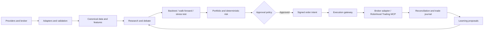

# Institutional Blueprint for an AI-Assisted Quantitative Trading Platform

| Document attribute | Specification |
|---|---|
| **Document status** | Definitive engineering design specification |
| **Intended implementation environment** | Claude Code project with modular Python services |
| **Primary brokerage integration** | Robinhood Trading MCP, subject to runtime capability discovery and explicit authorization |
| **Initial live scope** | Equities only unless the broker capability contract proves additional support |
| **Operating posture** | Research-first, evidence-gated, human-supervised, simulation default |
| **Author** | Manus AI |
| **Version** | 1.0 |

> **Important operating boundary.** This document is an engineering blueprint, not investment advice, an investment recommendation, an authorization to trade, a performance forecast, or a claim that the system will be profitable. Every trade is uncertain. The platform must require evidence, enforce risk limits, preserve human oversight, and make it straightforward to stop activity.

## 1. Executive Summary

This specification defines an institutional-quality, modular platform for research, validation, systematic strategy development, portfolio construction, risk control, controlled broker execution, surveillance, and learning. It is intended to be built with Python, production-grade operational practices, and Claude Code as the implementation assistant. The platform is not a monolithic “autonomous trader.” It is a collection of independently testable services and workflows that convert data into auditable hypotheses, hypotheses into testable strategy candidates, and only then—after deterministic controls and approval—into constrained order intents.

The central philosophy is that **automation is not authority**. Generative models are useful for synthesizing research, identifying conflicting evidence, extracting structured facts, drafting analyses, and proposing tests. They are not trusted sources of prices, portfolio state, risk limits, execution status, or legal compliance. Deterministic services remain authoritative for data validation, accounting, risk calculations, portfolio constraints, order state, approvals, and audit evidence. An AI agent may propose; only policy-governed services may approve; only a tightly scoped execution gateway may request broker action.

The initial broker adapter targets Robinhood Trading MCP, but the design intentionally does not assume a particular tool name, order type, asset type, latency, or authentication flow. The adapter must query and record the broker’s currently available capabilities at startup and compare them with a signed allowlist. Official Robinhood material describes a dedicated Agentic account, broad read access to certain account and trading data, and broker-side restrictions that limit agent trade placement to the Agentic account.[1] Robinhood’s launch material describes Agentic Trading as beta functionality with equities supported initially; therefore, the platform must regard options, crypto, futures, margin behavior, and advanced order constructs as unavailable until explicitly verified in the live capability contract.[2]

The architecture is composed of seven planes: a control plane for policies and configuration; a data plane for validated and lineage-rich market information; a research plane for reproducible experiments; a decision plane for strategies, debate, portfolio construction, and approvals; an execution plane for safe broker interaction; an observability plane for logs, metrics, and audit artifacts; and a learning plane for post-trade review and controlled improvement proposals. These planes are separated so that a failure, hallucination, malformed feed, or agent disagreement is contained rather than silently converted into a trade.

The platform’s objectives are to improve decision quality, reproducibility, operational safety, and learning velocity. It will continuously ingest data, refresh research, replay backtests, monitor data and model drift, evaluate strategy scorecards, and generate engineering tasks. It will not continuously modify live code, prompts, models, risk limits, broker settings, or strategy parameters. All material production changes require a versioned proposal, test evidence, independent review, approval, staged rollout, and rollback path.

## 2. Scope, Non-Goals, and Design Principles

### 2.1 Scope and limitations

The platform supports the lifecycle from data ingestion and research to backtesting, portfolio construction, deterministic risk control, constrained execution, reconciliation, and learning. It operates in **research-only**, **simulation**, **paper**, **approval-required live**, and narrowly configured autopilot modes; the initial default is simulation-only. It does not promise return, alpha, availability, correct forecasts, or faultless execution. It does not make suitability, legal, tax, fiduciary, or personalized investment determinations.

| Principle | Design consequence |
|---|---|
| **Modularity and testability** | Each domain has narrow, versioned contracts and replaceable adapters. Strategies never call a broker or secrets store. |
| **Determinism where possible** | Data validation, risk arithmetic, approvals, idempotency, accounting, and order state are deterministic and independently tested. |
| **AI where it adds reasoning value** | Models synthesize evidence, propose hypotheses, and challenge assumptions; they do not own prices, portfolio state, policy, or production mutation. |
| **Reproducibility and explainability** | Inputs, code, configuration, prompts, model ID, source links, calculations, assumptions, confidence, and counterevidence are retained. |
| **Fault tolerance and security** | External data and model output are untrusted until validated. Stale, unknown, or ambiguous live state fails closed. Secrets are absent from prompts, logs, and memory. |
| **Evidence and human control** | Unsupported claims cannot increase exposure. Live orders, risk-limit increases, production releases, and connector changes require policy-defined approval. |

### 2.2 System context and broker boundary



The Robinhood integration is a provider-neutral `BrokerGateway` adapter, not an LLM tool. It discovers and records available MCP tools at startup, compares them with an approved allowlist, and exposes only verified actions. Official Robinhood material describes a dedicated Agentic account, read access to specified account data, and trade placement limited to that account.[1] It also describes Agentic Trading as initially supporting equities; other asset classes and order capabilities remain unavailable until the runtime capability contract verifies them.[2]

| Broker rule | Required implementation |
|---|---|
| **State freshness** | Requery account, positions, buying power, open orders, and session status immediately before submission. |
| **Account binding** | Reject any intent not tied to the configured Agentic execution account. |
| **Signed authority** | Require a nonexpired approval record, risk/compliance results, policy version, and immutable intent fingerprint. |
| **Idempotency** | Reconcile by intent and broker order identity after any timeout; never blindly retry a possible submission. |
| **Failure** | Unknown capability, schema drift, stale state, authentication error, or ambiguous broker response becomes `BLOCKED_PENDING_RECONCILIATION`. |

> “Your agent can only place trades in your Robinhood Agentic account.” — Robinhood Agentic Trading overview [1]

## 3. Repository Structure

The repository must be a single production repository with Python packages, infrastructure artifacts, documentation, scripts, tests, and versioned decision records. Folder names correspond to clear ownership and import boundaries. Runtime state, credentials, raw records, and generated reports must not be committed to source control.

```text
quant-platform/
├── README.md
├── pyproject.toml
├── uv.lock
├── Makefile
├── .gitignore
├── .env.example
├── docker-compose.yml
├── compose/
│   ├── local.yml
│   ├── staging.yml
│   └── production.yml
├── config/
│   ├── base/
│   ├── environments/
│   ├── policies/
│   ├── risk_limits/
│   ├── strategy_profiles/
│   ├── broker_capabilities/
│   ├── feature_flags/
│   └── schemas/
├── agents/
│   ├── common/
│   ├── orchestration/
│   ├── analytical/
│   ├── challenge/
│   ├── control/
│   ├── learning/
│   ├── prompts/
│   ├── contracts/
│   └── evaluations/
├── memory/
│   ├── episodic/
│   ├── semantic/
│   ├── market/
│   ├── journals/
│   ├── retrieval/
│   ├── retention/
│   └── knowledge_graph/
├── research/
│   ├── hypotheses/
│   ├── notebooks/
│   ├── event_studies/
│   ├── factor_research/
│   ├── sources/
│   ├── experiment_registry/
│   └── evidence_bundles/
├── strategies/
│   ├── base/
│   ├── trend/
│   ├── momentum/
│   ├── mean_reversion/
│   ├── breakout/
│   ├── volatility/
│   ├── pairs/
│   ├── sector_rotation/
│   ├── statistical_arbitrage/
│   ├── factors/
│   ├── machine_learning/
│   ├── registry/
│   └── validation/
├── execution/
│   ├── intents/
│   ├── approvals/
│   ├── broker_gateway/
│   ├── robinhood_mcp/
│   ├── order_state/
│   ├── reconciliation/
│   ├── simulators/
│   └── surveillance/
├── portfolio/
│   ├── optimizer/
│   ├── allocator/
│   ├── rebalancing/
│   ├── exposures/
│   ├── attribution/
│   └── accounting/
├── risk/
│   ├── pre_trade/
│   ├── intraday/
│   ├── limits/
│   ├── scenarios/
│   ├── correlation/
│   ├── liquidity/
│   ├── circuit_breakers/
│   └── kill_switches/
├── optimization/
│   ├── parameter_search/
│   ├── objective_functions/
│   ├── constraints/
│   ├── walk_forward/
│   └── robustness/
├── backtesting/
│   ├── engine/
│   ├── market_replay/
│   ├── costs/
│   ├── benchmarks/
│   ├── monte_carlo/
│   ├── reports/
│   └── fixtures/
├── monitoring/
│   ├── metrics/
│   ├── tracing/
│   ├── data_quality/
│   ├── model_drift/
│   ├── broker_health/
│   └── service_level/
├── dashboard/
│   ├── frontend/
│   ├── backend/
│   ├── auth/
│   ├── screens/
│   └── components/
├── database/
│   ├── migrations/
│   ├── models/
│   ├── repositories/
│   ├── seeds/
│   └── retention_jobs/
├── tests/
│   ├── unit/
│   ├── contract/
│   ├── integration/
│   ├── simulation/
│   ├── stress/
│   ├── regression/
│   ├── performance/
│   ├── security/
│   └── acceptance/
├── scripts/
│   ├── bootstrap/
│   ├── data_ops/
│   ├── migration/
│   ├── release/
│   └── recovery/
├── docs/
│   ├── architecture/
│   ├── runbooks/
│   ├── adr/
│   ├── api/
│   ├── operations/
│   ├── security/
│   ├── strategy_playbooks/
│   └── governance/
├── api/
│   ├── public/
│   ├── internal/
│   ├── schemas/
│   ├── middleware/
│   └── authorization/
├── mcp/
│   ├── clients/
│   ├── adapters/
│   ├── tool_contracts/
│   ├── capability_discovery/
│   └── sandboxes/
├── logs/
│   └── .gitkeep
├── reports/
│   ├── daily/
│   ├── weekly/
│   ├── monthly/
│   ├── backtests/
│   └── incidents/
├── alerts/
│   ├── policies/
│   ├── templates/
│   ├── routing/
│   └── escalation/
└── pipelines/
    ├── ingestion/
    ├── research/
    ├── validation/
    ├── execution/
    ├── post_trade/
    └── maintenance/
```

| Area | Ownership and allowed writes | Prohibited coupling |
|---|---|---|
| **config/** | Versioned policy and nonsecret configuration. Changes require schema validation and policy review. | No plaintext credentials, mutable run state, or Python business logic. |
| **agents/** | Prompt templates, output contracts, evaluations, and orchestrators. Agents write proposals and evidence records only. | No direct database mutation or broker invocation. |
| **strategies/** | Pure signal logic and strategy metadata. Strategies return targets or intents, not orders. | No access to secrets, broker sessions, or UI state. |
| **execution/** | Signed intents, broker adapter, order-state machine, reconciliation, and simulators. | No unreviewed strategy changes or prompt-generated executable code. |
| **risk/** | Deterministic controls and scenarios. Risk can block but never silently loosen a limit. | No LLM-overridable policy path. |
| **memory/** | Versioned summaries, embeddings, source links, retention metadata, and audit-safe retrieval. | No raw credentials, unrestricted personal data, or unverified facts marked as truth. |
| **database/** | Migrations and repository boundaries. | No ad hoc production queries from agents or dashboards. |
| **reports/** and **logs/** | Generated, retained outside Git according to lifecycle policy. | No use as a source of control-plane truth. |

## 4. Data, State, and Interface Contracts

Every domain object must be governed by a versioned schema. Schemas are part of the platform’s public internal API and must be compatible with backward-compatible evolution rules. The minimum universal metadata fields are: `event_id`, `correlation_id`, `causation_id`, `schema_version`, `created_at_utc`, `as_of_utc`, `source`, `source_record_id`, `content_hash`, `quality_score`, `confidence`, `policy_version`, and `code_version`.

The most important state transitions occur through four contracts. A **ResearchClaim** contains a falsifiable statement, sources, contrary evidence, date bounds, and confidence. A **SignalProposal** contains strategy version, universe, feature snapshot, target horizon, signal direction, expected uncertainty, and invalidation condition. An **OrderIntent** contains the proposed instrument, side, size or notional, rationale, maximum acceptable risk, expiry, required approvals, and a deterministic fingerprint. An **ExecutionRecord** contains broker acknowledgement, status transitions, fills, fees, timestamps, reconciliation result, and any discrepancy.

A state machine, not a chat transcript, is authoritative for trade lifecycle. Every OrderIntent begins in `DRAFT` and can transition only through `VALIDATED`, `RISK_APPROVED`, `HUMAN_APPROVED` when required, `SUBMITTED`, `ACKNOWLEDGED`, `PARTIALLY_FILLED`, `FILLED`, `CANCELLED`, `REJECTED`, `EXPIRED`, or `BLOCKED_PENDING_RECONCILIATION`. State transitions must be transactionally recorded before side effects. The execution gateway may submit only an intent that is within its approval window and whose current broker snapshot is consistent with the intent’s assumptions.

## 5. Multi-Agent Architecture

### 5.1 Operating model and common agent card

The ensemble is a structured review system, not an unbounded group chat. Analytical agents generate sourced hypotheses; challenge agents find alternative explanations; control agents test feasibility; and orchestrators synthesize within hard policy boundaries. All agents are read-only by default. The only component permitted to request broker action is the deterministic execution gateway, acting on a signed intent.

| Required card element for **every agent** | Mandatory implementation |
|---|---|
| **Purpose, responsibilities, inputs, outputs, interactions** | The role catalog below defines the unique domain, required evidence, recipient, and typed output for each agent. Inputs are schema-validated and timestamped; outputs carry claim IDs, source IDs, confidence, uncertainty, expiry, and invalidation conditions. |
| **Internal reasoning process** | Verify freshness → retrieve only authorized evidence → analyze the role-specific question → test contrary explanations → quantify uncertainty → validate schema → emit an evidence trace. The platform does not request hidden reasoning; it records claims, sources, checks, assumptions, and conclusion. |
| **Constraints and failure conditions** | No secrets, direct broker calls, unsupported facts, unbounded tool use, or production writes. Missing, stale, contradictory, unvalidated, or unsafe inputs; model outage; or invalid schema causes abstention and escalation, never fabricated completion. |
| **Metrics** | Schema-valid rate, citation coverage, calibration, abstention quality, latency, correction rate, and downstream acceptance. The catalog adds a role-specific metric. |
| **Memory usage** | Read only role-scoped, cited episodic, semantic, market, error, and strategy records; write compact evidence-linked summaries, never raw hidden reasoning. The catalog names the primary memory emphasis. |
| **Prompt and improvement** | Every prompt includes as-of time, data-quality status, permitted input IDs, output schema, evidence requirement, uncertainty field, and “do not execute an order.” The catalog supplies the role-specific task and improvement path. |

### 5.2 Role catalog

| Agent | Purpose and responsibilities | Inputs → outputs; interactions | Role-specific focus, memory, prompt, and improvement |
|---|---|---|---|
| **CEO** | Maintains capital-preservation posture and governance priorities. | Risk, incidents, scorecards → escalations; with CIO, Risk, Compliance, Final Decision. | Tests objective conflicts; measures unresolved controls; uses quarterly/incident memory. Prompt: “State governance actions, not trades.” Improve OKR/control tracking. |
| **Chief Investment Officer** | Converts approved objectives into research mandates, universe, and strategy budgets. | Evidence, regime, risk appetite → research/allocation directives; with Portfolio and Risk. | Compares opportunity to uncertainty; tracks decision reversal; reads strategy/regime memory. Prompt: “Prioritize evidence-backed research.” Improve blind historical scoring. |
| **Research** | Creates falsifiable, source-cited research dossiers. | Mandate, sources, prior research → hypothesis/test plan; to analytical and Strategy agents. | Checks provenance and expiry; measures citation completeness; uses semantic research memory. Prompt: “State claim, evidence, counterevidence, test.” Improve automated claim verification. |
| **Macro** | Assesses macro regime and scheduled-event risk. | FRED/ALFRED, calendars → regime cautions; with Market Regime, Portfolio, Risk. | Checks vintage and release timing; measures event-risk recall; uses macro memory. Prompt: “Separate observed indicators from interpretation.” Improve vintage comparison. |
| **Fundamental** | Evaluates issuers, filings, valuation context, and corporate actions. | EDGAR, fundamentals, calendar → dated thesis/anomalies; with Bull, Bear, Strategy. | Reconciles identifiers and periods; measures source linkage; uses issuer history. Prompt: “Cite filing dates and disconfirmers.” Improve XBRL validation. |
| **Technical** | Produces reproducible price-volume context. | Adjusted bars/features → horizon-specific technical state; with signal strategies and Risk. | Tests adjustment and gaps; measures feature integrity; uses market-state memory. Prompt: “Report state, invalidation, limits.” Improve multi-timeframe diagnostics. |
| **Sentiment** | Converts approved text into uncertain entity-level sentiment features. | Deduplicated text → sentiment signals; with News, Research, ML. | Checks entity/source manipulation; measures calibration; uses sentiment history. Prompt: “Give source distribution and uncertainty.” Improve bot/multilingual filters. |
| **News** | Detects and classifies material, time-stamped events. | Permitted feeds/filings → event records; with Research, Compliance, Journal. | Tests novelty and source quality; measures correction rate; uses event memory. Prompt: “Record facts, entities, time, follow-up.” Improve primary-source ranking. |
| **Volatility** | Assesses volatility state, gap, and tail risk. | Price/volatility/scenario data → controls to tighten; with Risk and Sizing. | Tests estimate stability; measures forecast error; uses volatility history. Prompt: “State regime and conservative implication.” Improve robust estimators. |
| **Liquidity** | Determines tradeability and expected impact. | Quotes/volume/execution records → eligibility/capacity; with Execution, Risk, Sizing. | Blocks sparse depth assumptions; measures slippage error; uses execution memory. Prompt: “State safe capacity and uncertainty.” Improve impact curves. |
| **Portfolio** | Integrates eligible targets under budget and correlation constraints. | Signals, positions, limits → target portfolio; with CIO, Risk, Sizing. | Tests feasibility/marginal risk; measures concentration and turnover; uses allocation history. Prompt: “Explain constraints and dropped targets.” Improve robust optimization. |
| **Execution** | Validates and routes signed intents through the gateway. | Intent, broker snapshot, capability/approval → ready/block status; with Liquidity, Risk, Compliance. | Checks freshness/idempotency; measures reconciliation latency; uses incident memory. Prompt: “Return readiness or exact block.” Improve broker simulation. |
| **Risk** | Enforces deterministic exposure, loss, volatility, and operational limits. | Positions, targets, policies → pass/fail/headroom; with all control agents. | Applies conservative assumptions; measures breach escape rate; uses risk/breach memory. Prompt: “Apply policy; show binding constraints.” Improve independent implementation checks. |
| **Compliance** | Screens configured restrictions, audit completeness, and policy adherence. | Instrument/account/intent/policy → clearance/block; with Risk and Execution. | Does not give legal advice; measures exception closure; uses policy history. Prompt: “Check configured rules, flag missing attestations.” Improve reviewed jurisdiction modules. |
| **Bull** | Produces the strongest falsifiable upside case. | Candidate dossier → catalysts/assumptions; with Bear, Debate, Strategy. | Includes opposing facts; measures catalyst accuracy; uses analogous cases. Prompt: “Make the strongest cited bull case.” Improve blind adversarial review. |
| **Bear** | Produces the strongest falsifiable downside case. | Candidate dossier → downside catalysts; with Bull, Risk, Debate. | Searches adverse regimes; measures downside recall; uses failure/drawdown memory. Prompt: “Make the strongest cited bear case.” Improve scenario libraries. |
| **Devil’s Advocate** | Finds hidden assumptions, leakage, and noncausal claims. | Full packet → objections/required tests; through Debate. | Uses counterfactuals; measures defects found; reads error memory. Prompt: “Find reasons this is wrong or unsafe.” Improve automated leakage detection. |
| **Debate** | Resolves factual disagreement and exposes unresolved questions. | Pro/con/control records → evidence matrix; with CIO and Chief Skeptic. | Requires citations and abstains on impasse; measures contradiction detection; uses debate history. Prompt: “List facts, disputes, missing tests.” Improve independent judging. |
| **Strategy** | Converts evidence into a versioned, testable rule specification. | Validated dossier/regime → strategy proposal; with Backtesting and Optimizer. | Requires data/cost/no-trade rules; measures specification completeness; uses registry. Prompt: “Define falsifiable rules and disable conditions.” Improve strategy DSL. |
| **Optimizer** | Finds robust, not peak, parameters and allocations. | Frozen spec/training windows → stable regions; with Backtesting and Portfolio. | Uses nested tests/sensitivity; measures OOS decay; uses experiments. Prompt: “Report robust regions and rejections.” Improve constrained Bayesian search. |
| **Machine Learning** | Builds supplemental, calibrated predictive features/models. | Versioned features/splits → model card/predictions; with Strategy and Performance. | Detects leakage/drift; measures calibration; uses feature/model memory. Prompt: “Issue a model card, not a trade.” Improve conformal uncertainty. |
| **Performance Reviewer** | Attributes outcomes against thesis, benchmark, and costs. | Reconciled trades/P&L → attribution/anomalies; with Learning and CIO. | Separates factor, execution, luck; measures coverage; uses scorecards. Prompt: “Audit outcome versus ex ante record.” Improve factor decomposition. |
| **Market Regime** | Classifies trend/range, volatility, liquidity, and macro states. | Market/macro features → regime probabilities/eligibility; with Macro, Strategy, Risk. | Uses hysteresis and uncertainty; measures transition detection; uses regime history. Prompt: “Classify and flag strategies to reduce.” Improve regime ensemble. |
| **Position Sizing** | Calculates conservative exposure from risk, volatility, liquidity, and correlation. | Signal/limits/market state → maximum size; with Portfolio and Risk. | Takes tightest bound; measures planned versus realized loss; uses sizing history. Prompt: “Compute only if all inputs pass.” Improve impact feedback. |
| **Backtesting** | Runs point-in-time, cost-aware strategy evaluation. | Frozen spec/data snapshot → result/bias report; with Optimizer and Stress Testing. | Tests leakage/costs; measures reproducibility; uses experiment registry. Prompt: “Report results, biases, and limits.” Improve intraday replay. |
| **Stress Testing** | Tests adverse market, liquidity, and operational scenarios. | Targets/scenarios → loss distribution/controls; with Risk and Volatility. | Tests tails, outages, breakers; measures scenario coverage; uses incidents. Prompt: “State failure thresholds and mitigations.” Improve event replays. |
| **Trade Journal** | Preserves append-only lifecycle record. | Events, evidence, fills → daily journal; with all stages and Learning. | Correlates every artifact; measures completeness; writes episodic memory. Prompt: “Assemble dated record and deviations.” Improve searchable timeline. |
| **Learning** | Converts verified outcomes into task proposals and scorecards. | Journals, attribution, drift → lessons/tasks; with CEO and engineering backlog. | Does not self-modify; measures recurrence reduction; uses all tiers. Prompt: “Propose evidence-linked change, tests, rollback.” Improve causal post-mortems. |
| **Chief Skeptic** | Runs final independent red-team of readiness. | Complete packet → hard blocks/research questions; with Risk, Compliance, Final Decision. | Assumes proposal unsafe; measures prevented incidents; uses failure memory. Prompt: “Find any reason not to proceed.” Improve blind randomized reviews. |
| **Final Decision** | Chooses `REJECT`, `RESEARCH_ONLY`, or `PROPOSE_FOR_APPROVAL`. | Complete packet → signed decision/expiry; with human approver and controls. | Cannot override Risk/Compliance or submit; measures reversal; uses decision history. Prompt: “Select permitted status and binding conditions.” Improve independent policy checker. |

### 5.3 Orchestration protocol

The orchestrator creates an immutable research case, fills evidence slots, runs independent challenge, then requires reproducible strategy, backtest, walk-forward, and stress artifacts before portfolio and control review. It enforces time, tool, and iteration budgets. A missing mandatory artifact, unresolved hard conflict, or agent cycle ends in abstention or research-only status. Model outages cannot block reconciliation or deterministic risk surveillance; they only block new AI-assisted proposals.

## 6. Complete Operating Workflow

| Stage | Deterministic gate and primary responsibility | Durable outputs and failure behavior |
|---|---|---|
| **1. Data collection** | Scheduled adapters collect market, fundamental, macro, calendar, corporate-action, broker, and approved text data with source rate limits. | Raw payload, source timestamp, retrieval timestamp, hash, provider status. Failed or incomplete fetches are recorded and not silently imputed. |
| **2. Validation** | Schema, freshness, range, cross-source, identifier, calendar, and corporate-action checks determine eligibility. | Quality report and quarantine status. Critical data defects block dependent live proposals. |
| **3. Research** | Research and analytical agents form cited, falsifiable claims against validated data. | Research dossier with hypothesis, source links, counterevidence, confidence, and expiry. |
| **4. Analysis** | Fundamental, technical, macro, sentiment, news, volatility, liquidity, and regime assessments form structured views. | Timestamped evidence matrix. Contradictions remain visible rather than averaged away. |
| **5. Debate** | Bull, Bear, Devil’s Advocate, Debate, and Chief Skeptic challenge causal claims, implementation assumptions, and omissions. | Resolved facts, contested claims, open questions, and decision-readiness score. |
| **6. Strategy design** | Strategy agent converts only validated hypotheses into a versioned rule specification. | Strategy specification, data contract, no-trade conditions, and test plan. |
| **7. Backtest** | Backtesting agent runs a reproducible historical evaluation with point-in-time data and cost model. | Result bundle, logs, code/config hashes, benchmark comparison, and bias report. |
| **8. Walk-forward testing** | Optimizer and Backtesting agent freeze parameter selection in training windows and evaluate rolling unseen windows. | Walk-forward scorecard, stable parameter regions, and performance decay analysis. |
| **9. Stress testing** | Stress Testing and Risk apply historical, Monte Carlo, liquidity, correlation, and outage shocks. | Scenario-loss distribution, triggered controls, and fragility assessment. |
| **10. Risk review** | Risk, Position Sizing, Portfolio, Liquidity, and Compliance independently calculate feasibility and policy adherence. | Signed risk result listing all binding limits, pass/fail status, and exceptions. |
| **11. Execution approval** | Final Decision issues only a permitted status; a human approver signs when policy requires it. | Immutable approval or rejection record, expiry, and policy version. |
| **12. Execution** | Execution gateway reacquires broker state, validates signature and idempotency, and submits allowed orders through the adapter. | Broker request/response record. Ambiguity causes reconciliation, not retry. |
| **13. Monitoring** | Monitoring observes service health, data freshness, exposure, fills, price moves, limits, and broker connectivity. | Metrics, alerts, potential circuit breaker or kill-switch actions. |
| **14. Post-trade review** | Trade Journal and Performance Reviewer reconcile fills and attribute results against the ex ante thesis. | Complete journal, attribution, execution quality, and discrepancy report. |
| **15. Learning and memory update** | Learning extracts evidence-backed lessons, updates rankings only as a proposal, and opens engineering tasks. | Versioned lesson records, strategy scorecard updates, and approval-required change proposals. |

The sequence must be restartable. If a worker dies after creating an OrderIntent but before submission, the workflow resumes from durable state. If an order submission response is lost, the system first queries broker activity and reconciliation records. If a broker session is unavailable, the current state is preserved and the order is never duplicated. If monitoring detects a severe discrepancy, new proposals and new execution are suspended while reconciliation continues.

## 7. Data Layer

### 7.1 Provider strategy

Source adapters normalize data without erasing its provider identity, timestamp, entitlement, adjustment convention, or quality score. OpenBB may be used as an optional abstraction layer because its independent provider extensions are replaceable, but it does not host underlying data and is not a substitute for validation or service guarantees.[6] Free or unofficial data must never be assumed exchange-grade, complete, licensed for every use, or sufficiently fresh for a critical decision.

| Provider | Role, limitation, and mandatory control |
|---|---|
| **OpenBB** | Optional connector normalization. Preserve original source beneath its output; cache raw and normalized forms separately.[6] |
| **Yahoo Finance** | Research/prototyping source only. Cross-check critical prices and corporate actions; never assume institutional real-time quality. |
| **SEC EDGAR** | Official filings and extracted XBRL facts. Use throttled, cache-first requests with a descriptive user agent; SEC guidance calls for efficient access and limits use to no more than 10 requests per second per user.[4] |
| **FRED / ALFRED** | Macro and vintage-aware history. Record observation, release, vintage, and retrieval dates because revisions can affect historical research.[5] |
| **Alpha Vantage / Finnhub free tiers** | Supplemental feeds only after documented quota, entitlement, coverage, and fallback review. |
| **Stooq** | Secondary historical or end-of-day cross-check; document coverage, timezone, and adjustment method. |
| **Market and economic calendars** | Session and event guards. Version snapshots, cross-check broker state, and fail closed on conflict. |
| **Corporate actions** | Splits, dividends, symbol changes, delistings, and spin-offs. Reconcile against primary and independent sources, preserve raw events, and rerun affected evaluations after corrections. |

### 7.2 Canonical contract, validation, and caching

Every observation includes source, source record ID, event time, ingestion time, as-of time, timezone, schema version, content hash, adjustment policy, and quality score. Eligibility states are `QUARANTINED`, `VALID_FOR_RESEARCH`, `VALID_FOR_BACKTEST`, `VALID_FOR_STAGING`, `VALID_FOR_LIVE`, and `EXPIRED`. Validation covers schema, gaps, duplicates, monotonicity, identifier mapping, calendar alignment, timestamp normalization, price-volume plausibility, corporate actions, cross-source checks, provider entitlement, and freshness.

Cache four layers: immutable raw payloads; normalized observations; derived features with input hashes; and research artifacts with expiry/source links. Corrections, corporate actions, provider revisions, or quality downgrades trigger explicit invalidation and selective recomputation. A low-quality record may remain for diagnostics but cannot drive a live decision.

## 8. Memory System

The memory system is an audit-friendly knowledge service, not an unbounded chat history. It stores concise, sourced, access-controlled records that can be retrieved by role, entity, time window, market regime, strategy version, and confidence. It must retain original source links and summary provenance, distinguish fact from interpretation, and prevent a prior unverified claim from becoming an assumed truth.

| Memory tier | Contents and retention | Indexing, retrieval, and controls |
|---|---|---|
| **Episodic memory** | Individual research cases, decisions, approvals, executions, incidents, and post-trade reviews. Retain immutable event summaries for the regulated or organizational retention period. | Index by correlation ID, instrument, strategy, date, decision outcome, and incident class. Retrieve exact episodes for audit and analogical review. |
| **Semantic memory** | Curated concepts, strategy definitions, source trust notes, policy interpretations, and validated lessons. Retain through versioned deprecation. | Vector search plus structured tags; every semantic statement links to source episodes and reviewer status. |
| **Market memory** | Regime labels, macro releases, volatility events, liquidity disruptions, corporate actions, and market narratives. Retain long horizon for regime analysis. | Index by as-of time, event type, asset class, geography, and regime; prevent future information leakage in historical retrieval. |
| **Trade history** | Reconciled order lifecycle, fills, fees, P&L, exposures, and exception records. Retain append-only. | Query by order/intent ID, account, strategy, venue, symbol, and period; access controlled because it is sensitive financial information. |
| **Strategy history** | Versions, hypotheses, train/test windows, parameters, test outputs, promotions, rollbacks, and scorecards. | Index by strategy ID, code/config hash, universe, regime, and status. A live strategy must point to a frozen history record. |
| **Error history** | Data defects, model failures, broker errors, control breaches, false positives, and incident post-mortems. | Index by component, severity, root cause, and corrective action. Use for red-team and regression suites. |
| **Research history** | Evidence bundles, source evaluations, literature summaries, rejected hypotheses, and debate outcomes. | Index by entity, concept, source, date, claim status, and citation. Use citations as retrieval anchors. |
| **Daily journals** | A daily operational and trading narrative with material alerts, decisions, outcomes, and open risks. | Search by day and correlation ID; immutable original plus append-only corrections. |
| **Weekly reviews** | Aggregate performance, risk, data quality, model health, incidents, and backlogs. | Retrieve by week, strategy, and owner; used by CIO and CEO governance review. |
| **Monthly reviews** | Capital allocation, strategy ranking, control effectiveness, drift, and operational cost analysis. | Retain as governance artifacts with approval status. |
| **Annual reports** | Long-horizon methodology, control review, strategy lifecycle, security and disaster-recovery test evidence. | Retain indefinitely or under organizational policy; link to ADRs and release records. |

Vector search is useful for semantic recall but must never be the sole authority for facts. Retrieval should first apply structured filters—role, date, account scope, strategy, confidence, and source status—then vector similarity, then reranking by evidence quality and recency. An optional knowledge graph can link instruments, issuers, strategies, agents, events, claims, and outcomes, but graph edges must carry provenance and confidence. Embeddings are treated as derived data and must be regenerated when source text is corrected, redacted, or reclassified.

## 9. Strategy Engine

A strategy is a versioned declaration of universe, data contract, features, signal, horizon, entry, exit, filters, cost model, risk budget, no-trade conditions, and evaluation plan. It returns targets or signal proposals, never broker orders. An unspecified data cutoff, corporate-action policy, cost model, or invalidation condition makes the strategy research-only.

| Family | Data and assumption | Rules, strengths, and failure modes |
|---|---|---|
| **Trend** | Adjusted prices, volume, volatility; persistence can exceed noise. | Confirm trend; exit reversal/time/volatility stop. Captures persistence but whipsaws in ranges. |
| **Momentum** | Point-in-time returns, liquidity, volatility; relative strength persists briefly. | Rank and rebalance; exit rank decay. Diversifies signals but can crash, crowd, and incur turnover. |
| **Mean reversion** | Prices, bands, event calendar; temporary deviations revert. | Enter confirmed overshoot; exit mean/stop/time. Fails in structural repricing or trend breaks. |
| **Breakout** | Ranges, volume, liquidity; range exit may continue. | Enter confirmed breakout; exit failure/trailing rule. Vulnerable to false breaks and gaps. |
| **Volatility** | Realized/implied volatility where valid; volatility state is informative. | Apply validated regime rule and strict sizing. Fails under jumps, stale surfaces, or tail shifts. |
| **Pairs** | Synchronized adjusted prices, relationship tests, feasibility; spread relation persists. | Enter divergence; exit convergence/break. Fails under relation break, leg imbalance, or borrow constraints. |
| **Sector rotation** | Sector returns, macro, breadth, valuation; leadership varies by regime. | Allocate by regime/rank; cap concentration. Fails under rapid rotation or correlated shocks. |
| **Statistical arbitrage** | Point-in-time universe, residuals, costs; residual effects persist. | Trade robust residuals with capacity filters. Vulnerable to leakage, crowding, and underestimated cost. |
| **Factor models** | Point-in-time fundamental/price/sector data; factor exposure is persistent. | Construct constrained exposures. Transparent but subject to long factor droughts and hidden concentration. |
| **ML signals** | Versioned features and temporal labels; model adds to baseline. | Use only within deterministic ensemble/controls. Fails under drift, leakage, and cost error; never triggers alone. |

Lifecycle states are `IDEA`, `RESEARCH`, `BACKTESTED`, `WALK_FORWARD_VALIDATED`, `STRESS_TESTED`, `PAPER`, `LIMITED_LIVE`, `ACTIVE`, `PAUSED`, `RETIRED`, and `REJECTED`. Promotion needs plausible mechanism, data integrity, robust parameters, cost-aware out-of-sample performance, risk compatibility, observability, and an approved rollback.

## 10. Portfolio Construction

Portfolio construction converts independently valid signals into a portfolio that is feasible as a whole. The objective is not to maximize a backtest statistic. It is to allocate limited risk budget across strategies, instruments, and regimes while respecting liquidity, correlations, cash, turnover, expected costs, and user-configured objectives. The optimizer must prefer a feasible, explainable, robust allocation over an unstable mathematical optimum.

| Portfolio control | Required approach |
|---|---|
| **Position sizing** | Use a deterministic maximum exposure based on configured risk per trade, volatility, invalidation or stop distance where applicable, expected gap loss, liquidity, and portfolio headroom. Take the most conservative binding limit. |
| **Capital allocation** | Assign strategy budgets by validated evidence quality, capacity, diversification contribution, drawdown history, and active regime—not trailing return alone. Maintain minimum cash reserve by policy. |
| **Strategy weighting** | Apply shrinkage and caps to prevent a high-variance or recently successful strategy from dominating. Reweight only on a scheduled, reviewed process. |
| **Risk budgeting** | Calculate marginal and total risk contribution using conservative covariance estimates and scenario losses. If estimates are unstable, reduce allocation rather than assume diversification. |
| **Correlation management** | Group exposures by issuer, sector, factor, region, strategy, and latent correlation cluster. Limit both direct and indirect concentration. |
| **Exposure limits** | Enforce gross, net, single-name, sector, factor, strategy, account, and cash limits. Limits are policy-as-data and cannot be widened by a strategy. |
| **Cash management** | Treat cash, unsettled funds, buying power, and reserves as separate concepts. Reconcile broker values immediately before live execution. |
| **Rebalancing** | Use thresholds, calendar windows, cost estimates, and tax or operational constraints where configured. Do not rebalance solely because target weights changed by an immaterial amount. |

The portfolio optimizer must emit an allocation explanation: original signals, binding constraints, dropped candidates, expected turnover, expected costs, marginal risk contribution, residual cash, and risk budget usage. An infeasible result is a valid outcome and must trigger a reject or research-only state rather than force the optimizer to violate a constraint.

## 11. Comprehensive Risk Framework

Risk is deterministic, centrally configured, and enforced before target construction, before approval, immediately before broker submission, during monitoring, and in reconciliation. No agent can weaken a hard limit.

| Control | Why it exists and enforcement |
|---|---|
| **Trade, daily, weekly, monthly, and drawdown limits** | Constrain single-idea and cumulative damage. Breach blocks new risk, triggers review, and may pause strategies. |
| **Correlation, concentration, and position limits** | Prevent apparently distinct trades from becoming one issuer, sector, factor, regime, or liquidity exposure. |
| **Liquidity and volatility limits** | Cap exposure to tradable capacity and reduce risk during unstable conditions. |
| **Duplicate, API, and state controls** | Intent fingerprints, idempotency, broker reconciliation, and fresh snapshots prevent accidental repeated or ambiguous orders. |
| **Market, data, and model controls** | Block activity during halts, unknown sessions, stale/discrepant data, invalid model outputs, or untested prompt changes. |
| **Circuit breakers and kill switches** | Pause strategy, instrument, portfolio, or global submission on defined losses, volatility, data, or operational triggers. Emergency stop uses an isolated, audited human path. |

A breaker may halt new exposure while preserving reconciliation and orderly monitoring. The default after restart, policy/connector change, critical data failure, or unreconciled broker event is a stricter non-live mode until all checks pass.

## 12. Backtesting, Walk-Forward Testing, and Robustness

Backtesting is evidence about a historical implementation, not a forecast. Reports must preserve code/configuration hashes, data snapshot, universe, period, fees, slippage, corporate-action treatment, benchmark, random seed, exclusions, and warnings. They must use point-in-time availability, realistic session and fill assumptions, liquidity/capacity constraints, and conservative costs.

| Validation item | Required implementation |
|---|---|
| **Walk-forward and holdout** | Select on rolling training windows, test on immediately unseen windows, then reserve an untouched final holdout. Never use observed holdout results to retune. |
| **Robustness** | Examine parameter neighborhoods, multiple seeds, Monte Carlo paths, scenario losses, and benchmark-relative attribution. A sharp optimum is a rejection signal. |
| **Metrics** | Report return distribution, volatility, downside deviation, drawdown, turnover, costs, capacity, exposures, correlation, tail loss, and benchmark-relative measures with uncertainty. |
| **Bias controls** | Enforce as-of data, historical membership, revision/vintage handling, experiment registry, complexity penalties, and realistic partial-fill/delay assumptions. |

Look-ahead, survivorship, revisions, data-snooping, overfitting, ignored costs, unrealistic fills, and narrative hindsight are release-blocking defects. Failed or negative research remains in the experiment registry.

## 13. Machine Learning Guardrails

Machine learning is permitted where it improves a well-defined measurement problem: ranking a broad, liquid universe; estimating calibrated conditional probability; detecting anomalies; classifying regimes; extracting structured information from filings; or forecasting execution cost. It is not appropriate as an unreviewed black-box instruction to buy or sell, a replacement for risk management, an oracle for prices, or a mechanism to make a live order on its own.

Feature engineering must use only features available at the decision time and document every transformation, missing-value treatment, normalization window, entity mapping, and data source. Labels must have a clear horizon and avoid overlap leakage. Validation uses temporal splits, nested selection where hyperparameters are tuned, realistic embargoes for overlapping observations, baseline comparisons, calibration assessment, and error analysis by regime and liquidity segment.

Retraining occurs on a defined schedule or after a reviewed drift trigger, never continuously without control. Each model release has a model card: purpose, data cutoff, inputs, labels, architecture, baseline, evaluation, calibration, known failure modes, monitoring thresholds, approval owner, rollback version, and inference-cost profile. Drift monitoring tracks feature distributions, missingness, prediction distribution, calibration, target proxy changes, and realized strategy contribution. Ensemble methods may combine diverse, independently validated models, but the ensemble must remain interpretable at the level of weights, gating conditions, and contribution to the final strategy.

Every prediction must be confidence-calibrated. Low-confidence, out-of-distribution, high-drift, or stale-model predictions must be ignored or routed to research-only. The final trade path must include deterministic strategy logic, portfolio controls, risk checks, compliance checks, execution feasibility, and human approval according to policy. **No machine-learning prediction alone may trigger a trade.**

## 14. Self-Improvement Without Unauthorized Self-Modification

The learning system reviews every reconciled trade, rejected proposal, incident, data defect, model error, and operational near miss. It creates structured lessons from evidence rather than informal impressions. For example, it may identify a recurring failure of a mean-reversion rule during high-volatility regime transitions, a persistent divergence between modelled and realized slippage, or repeated missing corporate-action adjustments. It may then propose a new regression test, a revised data-quality rule, a research experiment, or a change to a strategy’s eligibility threshold.

The system can update **observational rankings** in a nonauthoritative scorecard, such as the evidence strength of a strategy across regimes, but it must not automatically change a live allocation, prompt, model, policy, or codebase. Any suggested change becomes an engineering or research task with problem statement, supporting records, expected benefits, risks, owner, acceptance tests, deployment plan, and rollback plan. A human or designated change-control process must approve it before implementation and another approval must promote it to production.

| Learning output | What it may do | What it must not do |
|---|---|---|
| **Trade review** | Add a journal entry, attribution record, and evidence-linked lesson. | Rewrite original thesis, hide a discrepancy, or alter a fill record. |
| **Strategy scorecard** | Update a research score and flag a strategy for review. | Auto-increase capital, change parameters, or reactivate a paused strategy. |
| **Drift alert** | Open an incident, require retraining research, or disable model-derived inputs. | Automatically retrain and deploy a production model. |
| **Engineering proposal** | Create a tracked task with acceptance and rollback criteria. | Modify production code, policies, prompts, or secrets. |
| **Prompt improvement proposal** | Recommend an evaluated template change with regression tests. | Replace a production prompt without review and release controls. |

## 15. Dashboard and Human Oversight

The dashboard is an operational control surface, not a promotional performance display. It must prioritize risk, freshness, exceptions, approvals, and explainability. All sensitive data is role-scoped. Every dashboard action that changes state requires reauthentication, reason capture, confirmation, and an audit event.

| Screen | Required information and permitted controls |
|---|---|
| **Portfolio** | Current and target allocations, gross/net exposure, cash, risk budget, correlation clusters, strategy contribution, and allocation deltas. It may display proposed rebalances but cannot bypass approval. |
| **Performance** | Reconciled P&L, benchmarks, drawdown, attribution, costs, turnover, strategy scorecards, and confidence intervals. It must distinguish realized, estimated, and unreconciled figures. |
| **Research** | Active hypotheses, evidence bundles, source provenance, experiment status, counterevidence, citations, and research-only recommendations. |
| **Risk** | All active limits, headroom, breaches, circuit-breaker status, data-quality state, stress-test results, and emergency actions with strict authorization. |
| **Open positions** | Instrument, quantity, basis, market value where verified, exposure, strategy ownership, risk contribution, liquidity state, and protective conditions. |
| **Historical trades** | Searchable lifecycle by intent/order ID with thesis, approvals, broker events, fills, fees, journal, and post-trade review. |
| **AI reasoning** | Evidence traces, input sources, claims, uncertainty, constraints, and refusal reasons. It must never display hidden model reasoning or raw secrets. |
| **Agent discussions** | Formal debate matrix, participants, citations, agreed facts, disputed points, and final decision status. |
| **Logs** | Role-filtered structured events, correlation IDs, service health, errors, and links to incident runbooks. |
| **Alerts** | Severity, owner, acknowledgement, escalation history, mitigation status, and related controls. |
| **Learning statistics** | Lesson validation rate, recurring-error trends, experiment throughput, strategy promotion funnel, model drift, and open improvement tasks. |

The dashboard must offer a prominent global execution status indicator: `SIMULATION`, `PAPER`, `APPROVAL_REQUIRED`, `LIMITED_AUTOPILOT`, `EXECUTION_PAUSED`, or `EMERGENCY_STOP`. The default state after deployment, restart, connector change, policy change, critical data defect, or unreconciled broker event is `EXECUTION_PAUSED` or a stricter non-live state until required checks pass.

## 16. Logging, Observability, and Auditability

Every module must use structured logs containing UTC timestamp, severity, service/module, environment, correlation ID, event ID, actor identity, request or job ID, schema version, code version, configuration hash, and sanitized error details. Logs must never contain secrets, full broker tokens, prompt-injected content treated as instruction, raw personal identifiers unless retention and access policy explicitly allow it, or confidential account values outside approved security boundaries.

| Module | Minimum audit events |
|---|---|
| **Data adapters** | Source request metadata, rate-limit decisions, response hash, validation result, freshness, quality score, cache hit/miss, and provider error. |
| **Agents** | Prompt template ID, model ID, permitted input record IDs, tool calls, output hash, schema validation, citations, confidence, refusal, and latency. |
| **Strategies and backtests** | Strategy version, parameters, universe, data snapshot, feature hash, costs, benchmark, metrics, warnings, and reproducibility ID. |
| **Risk and compliance** | Policy version, input snapshot, computed exposures, every rule evaluation, pass/fail reason, exception request, and approver. |
| **Execution** | Intent ID, approval ID, broker capability version, account alias, preflight snapshot, submission request hash, response, state transition, fill, cancel, and reconciliation result. |
| **Memory and learning** | Retrieval query filters, memory IDs returned, source/summary links, lesson creation, retention action, and any redaction or correction. |
| **Dashboard and API** | Authenticated user/service identity, viewed sensitive record class, state-changing action, confirmation, reason, and response status. |

Metrics include data freshness, data-validation failure rate, provider error rate, agent schema-valid rate, citation coverage, agent abstention rate, backtest queue time, risk-check latency, approval latency, broker health, ambiguous-order count, reconciliation lag, fill quality, slippage, circuit-breaker triggers, model drift, and recovery-time objectives. Distributed traces must link a research case through decision, execution, reconciliation, and post-trade review.

## 17. Security, Resilience, and Disaster Recovery

The design assumes providers, models, storage, developers, and brokers can fail or be compromised. Separate identities, accounts, environments, data classes, and execution rights to minimize blast radius. The execution gateway is independently deployed, accepts only signed intents, validates every field and schema version, and exposes no general administrative path.

| Area | Mandatory control |
|---|---|
| **Secrets and environment** | Use a dedicated encrypted secret store, runtime injection, rotation, revocation, placeholder-only `.env.example`, and secret-redacting logs. |
| **Least privilege and access** | Separate ingestion, research, dashboard, risk, execution, and backup identities. Require MFA, role-based access, short sessions, and reauthentication for policy or emergency actions. |
| **Supply chain and inputs** | Lock and scan dependencies, verify provenance, maintain an SBOM, pin images, sanitize untrusted data, and test prompt-injection defenses. |
| **Storage and backup** | Encrypt transit/rest, scope keys by environment/data class, keep immutable tested backups in an independent failure domain. |
| **Recovery** | Define recovery objectives, break-glass access, broker-disconnect and reconciliation runbooks, restore drills, and mandatory non-live state before resuming. |

## 18. Testing and Quality Assurance

Testing is a release gate, not an afterthought. Every new strategy, agent prompt, provider adapter, policy change, database migration, and broker capability change must have a proportionate test plan. Tests run in local development, continuous integration, staging, and pre-production acceptance environments.

| Test type | Scope and success criteria |
|---|---|
| **Unit tests** | Pure functions for data validation, signal logic, sizing, limits, order fingerprints, state transitions, and serializers. Must be deterministic and fast. |
| **Contract tests** | Validate internal schemas, provider adapters, broker capability discovery, and MCP tool mappings against recorded or sandbox fixtures. |
| **Integration tests** | Exercise durable stores, queues, APIs, authentication, and component interaction with test credentials and synthetic data. |
| **Simulation tests** | Replay historical sessions, broker outcomes, partial fills, late data, disconnects, and strategy lifecycle flows without live side effects. |
| **Stress tests** | Apply volatility shocks, liquidity withdrawal, correlation spikes, queue backlog, provider outages, database latency, and broker timeouts. |
| **Regression tests** | Preserve prior incident, data-correction, prompt failure, and strategy defect cases as permanent fixtures. |
| **Performance tests** | Measure throughput, latency, memory, retry behavior, queue saturation, and dashboard query performance under expected and adverse load. |
| **Security tests** | Scan dependencies, test authorization boundaries, verify secret redaction, exercise prompt-injection defenses, and conduct authenticated penetration testing where appropriate. |
| **Acceptance tests** | Prove that a full lifecycle—from data to research to risk to approval to simulated execution to reconciliation—matches policy and audit expectations. |

Prompt changes must have an evaluation suite containing benign, adversarial, incomplete, stale, contradictory, and prompt-injection-like inputs. A prompt that produces an unsupported claim, attempts to call an unauthorized tool, omits uncertainty, or violates output schema must fail the release gate. Strategy code changes must demonstrate that historical outputs have changed only for documented reasons.

## 19. Deployment, Operations, and Release Management

Local development uses synthetic or recorded fixtures and never production broker credentials. Staging runs the complete lifecycle under explicit no-live policy and fault injection. Production isolates network, secrets, storage, monitoring, and execution identities. Docker images are minimal, reproducible, scanned, signed, and versioned. Services are independently deployable: ingestion, validation, research, backtest, risk, execution, reconciliation, API/dashboard, and monitoring.

| Deployment pattern | Tradeoffs, cost, and setup |
|---|---|
| **Scheduled workers with durable queues** | Best for ingestion, validation, research, backtests, and reports. Usually lower cost and simpler operations, but insufficient alone for continuous broker surveillance. Requires queues, scheduler, retries, dead-letter handling, and monitoring. |
| **Persistent supervised execution/reconciliation service** | Supports continuous broker health, event monitoring, and timely breakers. Higher operational/capacity cost and security burden; requires supervision, hardening, incident response, and high-availability design. |

CI runs formatting, type checks, unit/contract/integration/security tests, prompt evaluations, and targeted simulations. Artifacts are immutable and identified by commit, lockfile, timestamp, and image digest. Deployment uses approvals and progressive scope: research-only, paper, limited universe and capital, then policy-approved expansion. Each release records motivation, risk, migrations, changed strategies/prompts/models, tests, monitoring, owner, rollout, and rollback. Rollback restores artifact, configuration, model/prompt, and scheduler state without corrupting the audit ledger.

## 20. Documentation, Code, Prompt, and Change Standards

Python code must follow a documented style guide, static typing standard, linting configuration, test conventions, and public-interface discipline. Modules should be small, dependency-injected, and explicit about side effects. A new integration requires a contract, fake implementation, tests, observability, security review, runbook, and decommissioning plan. “Convenient” direct calls across domain boundaries are prohibited.

Prompt standards require a versioned template ID, declared role, permitted inputs, expected schema, refusal behavior, current-time requirement, evidence/citation requirement, uncertainty format, no-side-effect statement, and test corpus. Prompts must not embed secrets, live account numbers, unrestricted external content, or instructions obtained from untrusted sources. Model selection, temperature, tool permissions, and token limits are configuration with change control, not ad hoc settings.

Commit messages must use a consistent convention such as `type(scope): imperative summary`, followed by an explanatory body for material changes. Examples of types include `feat`, `fix`, `test`, `docs`, `risk`, `security`, `data`, `strategy`, and `ops`. Commits that change a strategy, risk policy, broker adapter, prompt, or migration must reference an issue, experiment, incident, or ADR.

Documentation is part of the definition of done. Each service needs architecture context, API contract, configuration reference, runbook, alert ownership, local setup, test instructions, and failure modes. Change logs summarize user-visible or operational impact. Architecture decision records describe context, alternatives, decision, consequences, security implications, rollback, and review date. A strategy playbook includes rationale, universe, data, assumptions, rules, risks, backtest protocol, live eligibility, monitoring, and retirement criteria.

## 21. Future Expansion Without Redesign

The provider and broker interfaces are designed for controlled expansion. A new broker implements the neutral `BrokerGateway` contract, declares its own capability snapshot, is tested with a simulator and contract suite, and receives a dedicated account configuration. Strategies never import a specific broker, so adding a broker does not change research or risk logic. A broker-specific order type is exposed only after a generic extension proposal and explicit policy support.

Additional asset classes require new instrument metadata, calendars, data providers, cost models, valuation conventions, liquidity rules, risk scenarios, settlement rules, compliance checks, and broker capability contracts. The platform must not label a strategy “multi-asset” merely because a provider offers symbols. Equities are the initial supported live domain; other asset classes remain research-only until their complete lifecycle is implemented and approved.

Alternative data enters through the same untrusted-data quarantine. A new source needs provenance, entitlement and privacy review, validation rules, sample coverage, latency profile, bias analysis, retention policy, cost profile, and experiment evidence. New research agents or strategy families are plugins that conform to the common contracts, memory policy, agent evaluation suite, and no-side-effect boundary. The orchestrator recognizes them through a registry rather than hard-coded branching.

## 22. Implementation Sequence and Acceptance Gates

Implementation should proceed in small, verifiable increments. Phase one establishes repository structure, configuration, canonical schemas, audit ledger, secret handling, simulator, and observability. Phase two establishes source adapters, validation, data catalog, corporate-action handling, and reproducible backtest foundations. Phase three implements research workflow, agent contracts, evidence memory, and evaluation harnesses. Phase four adds strategies, walk-forward, stress testing, portfolio construction, and risk engine. Phase five adds the broker adapter in read-only mode, capability discovery, reconciliation, and full simulated execution. Phase six introduces dashboard, operational runbooks, staging, and formal acceptance. Live execution is considered only after explicit human authorization and all policy gates are demonstrably satisfied.

| Go-live gate | Evidence required |
|---|---|
| **Data readiness** | Critical sources documented, source terms reviewed, validation dashboards live, corporate actions tested, freshness alerts tested, and fallbacks exercised. |
| **Research integrity** | Agent outputs schema-valid, cited, evaluated against adversarial inputs, and unable to invoke broker operations. |
| **Strategy validity** | Reproducible backtests, untouched holdout, walk-forward, conservative costs, parameter sensitivity, stress tests, and documented limitations. |
| **Risk readiness** | All limits tested, circuit breakers and kill switch exercised, policy immutability verified, and breach escalation runbook rehearsed. |
| **Broker readiness** | Capability snapshot approved, read-only reconciliation tested, simulated ambiguous submit tested, idempotency proven, and exact account binding confirmed. |
| **Operational readiness** | Monitoring, alert routing, incident ownership, backups, restore drill, deployment rollback, access review, and daily reconciliation defined. |
| **Human oversight** | Named owners, approval workflow, emergency-stop access, and clear confirmation that the account user understands the operational and loss risks. |

## 23. References

[1]: https://robinhood.com/us/en/support/articles/agentic-trading-overview/ "Robinhood — Agentic Trading overview"
[2]: https://robinhood.com/us/en/newsroom/robinhood-is-now-open-to-agents/ "Robinhood — Robinhood is Now Open to Agents"
[3]: https://robinhood.com/us/en/agentic-trading "Robinhood — Agentic Trading"
[4]: https://www.sec.gov/about/developer-resources "U.S. Securities and Exchange Commission — Developer Resources"
[5]: https://fred.stlouisfed.org/docs/api/fred/overview.html "Federal Reserve Bank of St. Louis — FRED API Overview"
[6]: https://docs.openbb.co/odp/python/extensions/providers "OpenBB — Providers"

---

**Final engineering directive:** Build the platform as a conservative, observable decision system. Treat evidence as perishable, models as fallible, data as imperfect, broker integrations as capability-limited, and live order placement as an exceptional action that must be earned through deterministic controls and human accountability.
